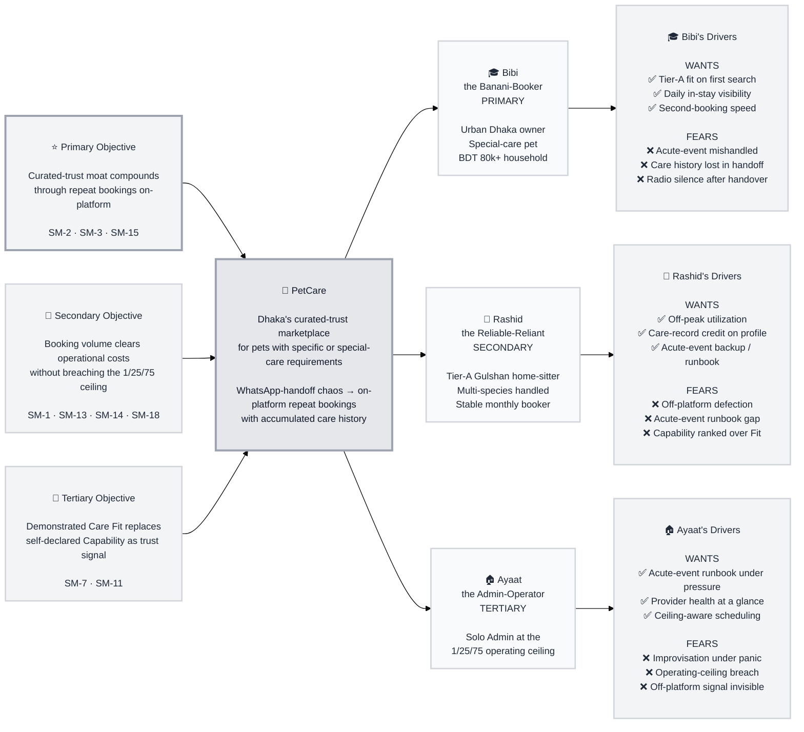

# Trigger Map Poster: PetCare

> Visual overview connecting business goals to user psychology

**Created:** 2026-08-30
**Author:** neamul haq
**Methodology:** Based on Effect Mapping (Balic & Domingues, inUse), adapted for the Whiteport Design Studio framework — simplified (no features in the trigger map) and enhanced with negative driving forces.

---

## Strategic Documents

This is the visual overview. For detailed documentation, see:

- **01-Business-Goals.md** — Full vision statement and 3-tier objectives with FR/SM anchoring
- **02-Bibi-the-Banani-Booker.md** — ⭐ Primary persona (Owner) with full transformation journey
- **03-Rashid-the-Reliable-Reliant.md** — 🔧 Secondary persona (Provider) with validation strategy
- **04-Ayaat-the-Admin-Operator.md** — 🏠 Tertiary persona (solo Admin) with organic discovery focus
- **03-Feature-Impact-Analysis.md** — 18 features scored across 4 sub-buckets (Primary-tier Must Have / Secondary Obj 2 Operational Constraint / Launch-Blocking Substrate / Consider)
- **04-Key-Insights.md** — *(renamed to 05-Key-Insights.md per WDS template convention; strategic implications, emotional transformation, dev-phase mapping)*

---

## Vision

PetCare aims to be the trusted, bookable marketplace in Dhaka that an owner with a special-care pet reaches for first — not the loudest, cheapest, or largest, but the one whose reputation is built on what providers have demonstrably handled well across species and care needs over time.

---

## Business Objectives

### Objective 1 — ⭐ Primary: Curated-trust moat compounds through repeat bookings on-platform

The moat is not the supply list or the brand; it is the accumulated care history that only grows when owners and providers keep transacting on the platform rather than defecting to WhatsApp after the first booking.

- **Metric:** Repeat-booking rate on-platform; share of bookings where the same owner re-books the same provider for a subsequent stay without leaving PetCare first.
- **Target:** Repeat-booking share becomes the dominant booking pattern within the pilot cohort (numerical targets deliberately deferred until post-pilot per Brief §4 / PRD §11 A-21).
- **Timeline:** Compounding effect measured across the pilot's first six months; meaningful share inflection expected by month 4–6 of steady-state operation.
- **Anchor (FRs / SMs):** FR-1, FR-7, FR-8, FR-11, FR-15, FR-26, FR-43, FR-44, FR-45, FR-48, FR-50; SM-2, SM-3, SM-15.

### Objective 2 — 🚀 Secondary: Booking volume clears operational costs without breaching the 1 / 25 / 75 operating ceiling

Volume must clear the fixed cost of a single Admin's time and the per-booking support burden without forcing Ayaat to exceed the operational ceiling where service quality collapses.

- **Metric:** Bookings per month per active provider; bookings per month per active Admin; share of providers active in a given month.
- **Target:** Aggregate monthly bookings clear fixed operational cost while Ayaat remains within the 1-admin / 25-provider / 75-bookings-month ceiling (numerical targets deferred per A-21).
- **Timeline:** Tracked monthly from launch; ceiling breach treated as a launch-blocking risk per PRD §11.
- **Anchor (FRs / SMs):** FR-4, FR-30, FR-32, FR-35, FR-38; SM-1, SM-13, SM-14, SM-18, SM-19, SM-20.

### Objective 3 — 🌱 Tertiary: Demonstrated Care Fit replaces self-declared Capability as the trust signal

The trust signal shifts from "provider says they can handle X" to "platform shows what providers have actually handled well across species and care needs." This is what makes Bibi reach for PetCare first on her first search.

- **Metric:** Share of provider profiles carrying demonstrated care-history evidence at the point of first-search; share of bookings where the owner cited a demonstrated-care-fit signal as the booking trigger.
- **Target:** Demonstrated care-history is the default presentation on every Tier-A provider profile; self-declared capability is presented only as a fallback when no history exists yet (numerical targets deferred per A-21).
- **Timeline:** Capability-to-Fit transition tracked across the pilot; full replacement targeted by the end of pilot phase 1.
- **Anchor (FRs / SMs):** FR-11, FR-21, FR-43, FR-44, FR-49; SM-7, SM-11.

---

## Target Groups (Prioritized)

### 1. 🎓 Primary — Bibi the Banani-Booker (Owner)

**Priority Reasoning:** Bibi's repeat-booking-on-platform is the engine of the curated-trust moat (Primary Objective 1). Without her trust compounding in-platform, the moat dissolves and the marketplace becomes a search-engine-shaped directory.

> Urban-Dhaka owner (Banani / Gulshan / Baridhara axis), BDT 80k+ household, female-skewing, owns a pet with a specific or special-care requirement — diabetic cat, post-surgery dog, anxious rescue, exotic species — and has already exhausted the WhatsApp-vendor loop at least once.

**Key Positive Drivers:**
- ✅ Tier-A fit on first search — a provider whose actual care-history matches Tito's diabetes without Bibi having to ask "do you know how to handle this?" (FR-11, FR-21, FR-43, FR-44, FR-49)
- ✅ Daily in-stay visibility — structured photo + note updates that show Tito's glucose curve and behaviour, not just a thumbs-up emoji (FR-15, FR-26, FR-45, FR-1)
- ✅ Second-booking speed — the second booking should take less time than the first, because care history is already attached to the pet record (FR-7, FR-8, FR-48, SM-15)

**Key Negative Drivers:**
- ❌ Acute-event mishandling — Tito's glucose drops overnight; the provider panics, guesses, or messages Bibi at 3am without a runbook; Bibi loses trust forever (FR-15, FR-26, FR-45, R-10)
- ❌ Care-history loss in handoff — the WhatsApp handoff between Bibi and the provider erases the careful record of Tito's insulin curve, diet, and triggers; the second provider starts from zero (FR-10, FR-50)
- ❌ Radio silence after handover — Bibi books, hands Tito over, then hears nothing until pickup; "no news" is read as "bad news she is hiding" (FR-15, FR-26, FR-1)

### 2. 🔧 Secondary — Rashid the Reliable-Reliant (Provider)

**Priority Reasoning:** Rashid is the supply foundation whose demonstrated-care-fit records are the trust signal Bibi searches against. Without his care-history being captured and surfaced, the Primary objective cannot be served.

> Tier-A Gulshan home-sitter, has handled several species including special-care cases, depends on PetCare for a stable share of monthly bookings, and is wary of being reduced to a commodity by an algorithm he doesn't control.

**Key Positive Drivers:**
- ✅ Off-peak utilization — PetCare fills the slow weeks between Eid peaks so Rashid's fixed home-sitting capacity doesn't sit idle (FR-36, SM-13)
- ✅ Care-record credit — every special-case Rashid handles well becomes part of his demonstrated profile, so the right owners find him without Rashid having to advertise (FR-20, FR-21, FR-49)
- ✅ Acute-event backup — when an acute event happens, Rashid has a clear runbook, an Admin escalation channel, and a way to reach Bibi's vet contact without panic (FR-14, FR-22, FR-35, FR-45)

**Key Negative Drivers:**
- ❌ Off-platform defection — owners book once through PetCare, then take Rashid's number to WhatsApp to skip the platform fee; Rashid's care history stops accruing to his profile and his utilization collapses back to word-of-mouth (FR-50, FR-10, FR-48, FR-49, SM-C1, SM-C2)
- ❌ Acute-event runbook gap — Rashid is on his own when an acute event happens; if he guesses wrong, he absorbs the blame and the review, not the platform (FR-14, FR-22, FR-35)
- ❌ Capability over Fit — Rashid is sorted and presented by self-declared capability ("I can handle diabetic cats") rather than by what he has demonstrably handled well; the wrong owners book him, the right ones never see him (FR-11, FR-21, FR-43, FR-44)

### 3. 🏠 Tertiary — Ayaat the Admin-Operator (solo Admin)

**Priority Reasoning:** Ayaat is the operational gatekeeper who decides whether acute events become trust-breakers or trust-builders. Her 1 / 25 / 75 ceiling is the binding constraint on Secondary Objective 2; her runbook discipline is the binding constraint on Primary Objective 1's acute-event promise.

> Solo operator running PetCare on her own at the 1-admin / 25-provider / 75-bookings-month operating ceiling. Every acute event lands on her phone; every quality issue lands on her inbox; every provider offboarding decision lands on her calendar.

**Key Positive Drivers:**
- ✅ Acute-event runbook under pressure — when an acute event happens, Ayaat has a pre-built escalation path, a vet-contact template, and a post-event parent-comms script she can fire in under five minutes (FR-26–30, FR-32, FR-45, SM-19, SM-20)
- ✅ Provider health at a glance — Ayaat can see the 25 providers' recent booking quality, response rate, and care-record completeness in one screen, so she catches problems before they become trust-breakers (FR-4, FR-35, FR-38)
- ✅ Ceiling-aware scheduling — Ayaat's intake flow tells her when she is approaching the 75-bookings-month line and lets her throttle new supply before service quality collapses (FR-38, SM-18)

**Key Negative Drivers:**
- ❌ Acute-event runbook under pressure — when an acute event happens and Ayaat does not have a runbook ready, she improvises under panic, sends contradictory comms, and the trust event becomes a public review instead of a private resolution (FR-26–30, FR-32, R-10)
- ❌ Operating-ceiling breach — Ayaat is forced past 75 bookings a month because volume kept climbing while her per-booking support burden did not drop; quality of every booking drops, and the moat starts dissolving (FR-38, SM-18)
- ❌ Off-platform defection signal invisible — Ayaat cannot tell from inside the platform when Bibi and Rashid have moved their second booking to WhatsApp, so the moat looks healthy on dashboard while it is actually leaking (FR-50, FR-10, FR-48, FR-49, A-14)

### 4. 🌐 Shared Cross-Group Driver — Off-Platform Defection

**Why shared:** Off-Platform Defection appears from three different angles — Bibi loses her care history in the WhatsApp handoff, Rashid loses his utilization when owners skip the platform, Ayaat loses the moat signal because the defection is invisible to her dashboard. Mitigating it closes the loop on all three.

> Once an owner and a provider have successfully transacted once, both sides have an incentive to move the next booking to WhatsApp to skip the platform fee. When they do, the care-history stops accruing to PetCare, the demonstrated-care-fit signal weakens, and the next owner's first search shows a thinner profile.

- ✅ Mitigation surface — FR-50 (off-platform soft-signal capture), FR-10 (care-history portability), FR-48 / FR-49 (provider profile deepening), FR-36 (off-peak utilization), A-14 (defection monitoring)
- ❌ Counter-evidence — SM-C1 (platform-booking share), SM-C2 (provider platform-share), SM-C5 (care-record completeness)

---

## Trigger Map Visualization

---

## Summary

### Primary Target with One-Line Transformation

**Bibi the Banani-Booker** — from "another WhatsApp-vendor gamble with Tito's insulin curve" → to "first-search confidence because PetCare already shows what providers have demonstrably handled well for diabetic cats."

### The Flywheel (Strategic Triangle)

1. 🎓 **Bibi** books and re-books on-platform → her repeat-booking compounds the trust moat *(Primary Objective 1)*
2. 🔧 **Rashid** captures care-history into his profile → demonstrated Fit, not self-declared Capability, becomes the signal Bibi's first search surfaces *(Tertiary Objective 3)*
3. 🏠 **Ayaat** enforces the 1/25/75 ceiling and runs the acute-event runbook → volume clears operational cost without service collapse *(Secondary Objective 2)*
4. 🐾 **PetCare** translates accumulated care-history into first-search confidence → Bibi's next booking starts from a richer profile *(loop closes on Primary Objective 1)*

### Key Transformation Statement

> PetCare's design effort transforms Bibi from "the owner who must re-explain Tito's diabetes every time" into "the owner whose first search already ranks providers by what they have demonstrably handled well" — while Rashid becomes the provider whose Fit is surfaced automatically and Ayaat becomes the operator whose runbook holds even when acute events happen at 3am.

---

## Design Focus Statement

> The PetCare design effort focuses on Bibi the Banani-Booker — the owner whose repeat-booking-on-platform is the engine of the curated-trust moat — by addressing her top fears (acute-event mishandling, care-history loss, radio silence) and top wants (Tier-A fit on first search, daily in-stay visibility, second-booking speed). Rashid and Ayaat are the supply/operational foundations; Off-Platform Defection is the shared cross-group driver whose mitigation closes the loop.

**Primary Design Target:** Bibi the Banani-Booker

**Must Address:**
- Tito's diabetes mishandled in an acute event — FR-15, FR-26, FR-45 *(Bibi Fear #1)*
- Care history lost in the WhatsApp handoff — FR-10, FR-50 *(Bibi Fear #2)*
- Second booking slower than the first — FR-7, FR-8, FR-48, SM-15 *(Bibi Want #3)*

**Should Address:**
- Rashid's off-peak utilization collapse — FR-36, SM-13
- Ayaat's acute-event runbook under pressure — FR-26–30, FR-32, SM-19 / SM-20
- Ayaat's operating-ceiling breach — FR-38, SM-18

**Shared:**
- Off-Platform Defection — FR-50, FR-10, FR-48 / FR-49, FR-36

---

## Cross-Group Patterns

### Shared Drivers

- **Off-Platform Defection** (promoted to shared cross-group driver per workshop decision): appears from Bibi's care-history-loss angle, Rashid's utilization-collapse angle, and Ayaat's invisible-signal angle. Mitigating it (FR-50 soft-signal capture + FR-10 care-history portability + FR-48/49 profile deepening + FR-36 off-peak utilization) closes the loop on all three personas.

### Unique Drivers

- **Bibi:** Radio silence after handover — uniquely the owner's anxiety surface; no other persona carries it.
- **Rashid:** Capability ranked over Fit — uniquely the supply-side misranking surface; the algorithm's failure mode is visible only from his angle.
- **Ayaat:** Operating-ceiling breach — uniquely the Admin-side capacity surface; the binding constraint of Secondary Objective 2 lives only here.

---

## How to Read This Trigger Map

- **Left → Right flow:** Business Goals drive the Platform, the Platform serves the Target Groups, and each Target Group's Driving Forces explain what the design must address.
- **Top → Bottom priority:** ⭐ Primary (the engine) → 🚀 Secondary (driven by Primary) → 🌱 Tertiary (benefits members once Primary and Secondary hold).
- **Driving-force symbols:** ✅ = positive want (what success looks like); ❌ = negative fear (what loss-averse design must prevent).
- **Primary Target outline:** Bibi's box is rendered with the strongest stroke (`stroke-width:3px`) so the design eye lands on her first.

---

## Next Steps

- [ ] **Review detailed docs** — See `01-Business-Goals.md`, `02-Bibi-the-Banani-Booker.md`, `03-Rashid-the-Reliable-Reliant.md`, `04-Ayaat-the-Admin-Operator.md`, `05-Key-Insights.md`, `03-Feature-Impact-Analysis.md`
- [ ] **Use for Feature Prioritization** — Reference feature impact scores in `03-Feature-Impact-Analysis.md`
- [ ] **Guide UX Design** — Ensure scenarios and surface design address the Must-Address drivers
- [ ] **Validate with Users** — Test the Bibi / Rashid / Ayaat assumptions with real Dhaka users during pilot onboarding
- [ ] **Update as Learnings Emerge** — This is a living document; revisit after the first 25 / 50 / 100 bookings

---

_Generated with the Whiteport Design Studio framework._
_Trigger Mapping methodology credits: Effect Mapping by Mijo Balic & Ingrid Domingues (inUse), adapted with negative driving forces._
