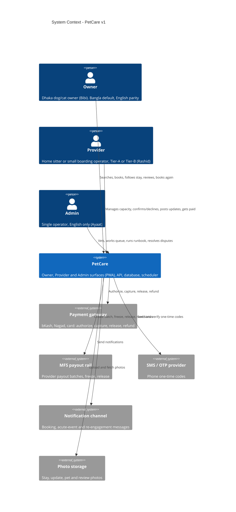
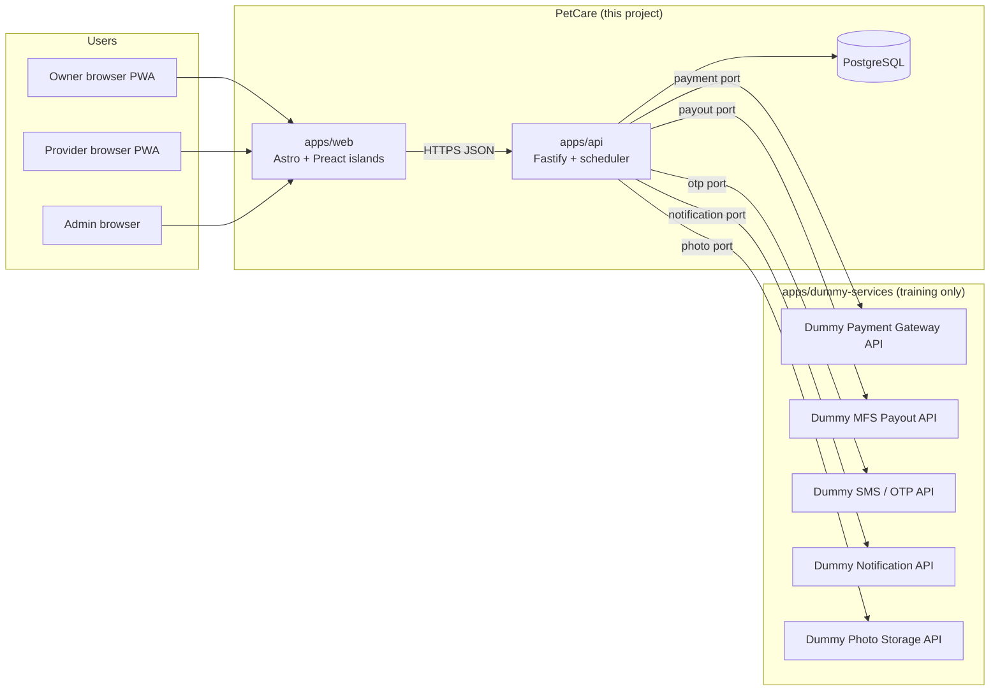

# PetCare v1 - System Context

Sources: approved [intent.md](intent.md), [requirements.md](requirements.md), `memory-bank/standards/` (tech stack, data stack, training decisions TD-1..TD-16), approved [ui-analysis.md](ui-analysis.md).
Rule carried through this document: **real conceptual systems are named for what they do; the Dummy APIs are training substitutes. No real bKash, Nagad, SSLCommerz, MFS or SMS contract is claimed or invented.**

## 1. System overview

PetCare is a curated pet-boarding marketplace for urban Dhaka (Gulshan, Banani, Baridhara; dogs and cats). It is one product with **three surfaces** (Owner `/`, Provider `/provider`, Admin `/admin`, English only), one **API**, one **relational database**, and a **scheduler** that runs inside the API process. It depends on five external capabilities (payment, payout, SMS/OTP, notifications, photo storage). In this training build each is replaced by a separately runnable **Dummy API** that the PetCare API reaches only through its own **ports and adapters**. The UI never calls an external or Dummy system directly (DR-22).

## 2. Context diagram (conceptual systems)

## 3. Training substitutes (what actually runs)

| Real conceptual system | Training substitute | Port in PetCare API | Contract status |
|---|---|---|---|
| Payment gateway (bKash, Nagad, card) | Dummy Payment Gateway API | payment port | Training contract only |
| MFS payout rail | Dummy MFS Payout API | payout port | Training contract only |
| SMS / OTP provider | Dummy SMS / OTP API | otp port | Training contract only |
| Notification channel | Dummy Notification API | notification port | Training contract only |
| Photo storage | Dummy Photo Storage API | photo port | Training contract only |

Swapping a Dummy for a real provider later means writing a new adapter behind the same port; no domain or UI code changes. The Dummy contracts are our own design (Step 16), not claims about any real interface (PRD OQs about the gateway stay open, A-8).

## 4. Actors

| Actor | Type | Surface | Responsibilities in the system |
|---|---|---|---|
| **Owner** | Human | `/` | Phone-OTP sign-in; pet profile and care configuration; search; booking request and authorization; follow stay; chat; verified review; report an issue; book again |
| **Provider** | Human | `/provider` | Admin-approved only (no self sign-up); capacity per date; confirm or structured decline; daily updates; chat; acute-event trigger; mark complete; payouts |
| **Admin** | Human | `/admin` (English only) | Vetting; urgency queue; acute-event coordination; disputes and refunds; review moderation; payout reconciliation; audit log; ceiling and defection monitoring. Separate authentication (FR-31) |
| **Scheduler** | System | inside API | Confirmation-window timeouts (TD-1), weekly payout batch (TD-3), update reminders (TD-11), stay-start SLA flag (TD-12), re-engagement evaluation (TD-10). Clock is injectable for tests and demos |
| **Guest** | Human (unauthenticated) | `/` | Browse marketing surfaces and public provider profiles; cannot book |

## 5. Systems and integration boundaries

For each external capability: what crosses the boundary, who owns the data, and what happens when it fails. Failure behaviour implements DR-21 and Step 35.

### 5.1 Payment gateway (Dummy Payment Gateway API)

| Aspect | Definition |
|---|---|
| Purpose | Authorize at booking request, capture on provider confirmation, release on decline/timeout/cancel, refund on resolution (FR-15, FR-39, FR-42) |
| Outbound (PetCare to gateway) | method (`bkash` / `nagad` / `card`), amount in BDT minor units, booking reference, **idempotency key**; capture/release/refund requests by authorization or payment id |
| Inbound (gateway to PetCare) | authorization id and status, capture result, refund result, gateway reference, failure reason |
| Data ownership | Gateway owns the money movement and any card data (NFR-9; PetCare stores tokens and references only). PetCare owns the booking, the payment event log (NFR-23) and the idempotency records |
| Dummy endpoints (training) | `POST /api/payments/authorizations`, `.../:id/capture`, `.../:id/release`, `POST /api/payments/:paymentId/refunds`, `GET /api/payments/:paymentId` |
| Failure boundary | **Down or timeout at authorization:** no booking created, user may retry. **Declined:** clear message, request not submitted. **Capture answer lost (ambiguous):** retry with the same idempotency key captures once, never twice (DR-13). **Refund failure:** stays pending and visible to admin; no silent loss |
| Rules | Nothing is captured at request (FR-39). Rate fixed on the booking at confirmation (TD-8). Platform absorbs gateway fees, not modelled (TD-16) |

### 5.2 MFS payout rail (Dummy MFS Payout API)

| Aspect | Definition |
|---|---|
| Purpose | Weekly batch payout to providers net of commission; freeze on report or acute event; release on resolution (FR-41, FR-24, FR-29) |
| Outbound | batch of payout lines (provider, booking, gross, commission rate, commission, net), freeze and release requests, idempotency key per batch and per line |
| Inbound | payout id, per-line status (queued, paid, frozen, hold), settlement reference |
| Data ownership | Rail owns settlement; PetCare owns payout records, commission snapshot and the link to the booking |
| Dummy endpoints | `POST /api/payouts/batches`, `.../:payoutId/freeze`, `.../:payoutId/release`, `GET /api/payouts/:payoutId` |
| Failure boundary | Rail down: payouts stay **queued**, retried at next run, **never paid twice** (DR-14). Frozen payouts are excluded from the batch (TD-3). Reconciliation drift is visible in admin page 4.8 |

### 5.3 SMS / OTP provider (Dummy SMS / OTP API)

| Aspect | Definition |
|---|---|
| Purpose | Phone-OTP sign-in for owners and providers (NFR-6, DR-1) |
| Outbound | phone (+880...), code request; verification attempt (phone, code) |
| Inbound | challenge accepted, delivery status, verify result |
| Data ownership | PetCare owns the session and the verified phone; the provider owns delivery. OTP codes are short-lived; attempt and resend limits are configuration |
| Dummy endpoints | `POST /api/otp/send`, `POST /api/otp/verify`; inspection view shows the code "sent" |
| Failure boundary | Service down or slow: **sign-in fails safely with a retry option**; delayed SMS handled by resend and cooldown (page 5.11). No account is created without a verified code |

### 5.4 Notification channel (Dummy Notification API)

| Aspect | Definition |
|---|---|
| Purpose | Booking events, daily-update reminders, acute-event notices (owner and admin), re-engagement messages, timeout notices (DR-12, DR-20). No native web push in v1 |
| Outbound | recipient, role, type, language (`bn` or `en`; admin `en`), body, deep-link target, booking reference |
| Inbound | accepted/queued/failed status |
| Data ownership | PetCare owns notification records and the in-app inbox (pages 5.5/5.9); the channel owns delivery |
| Dummy endpoint | `POST /api/notifications` (+ inspection) |
| Failure boundary | A delivery failure **never blocks the business action**: the event is recorded, delivery retried, admin sees failed deliveries. Acute-event owner notification keeps an in-app banner as a guaranteed fallback (FR-26) |

### 5.5 Photo storage (Dummy Photo Storage API)

| Aspect | Definition |
|---|---|
| Purpose | Pet photos, daily-update photos, verified-review photos (FR-21, FR-43). Photos only, no video (TD-15) |
| Outbound | image bytes with owner/booking tag, size limits (<= 5 MB), compression |
| Inbound | photo id and URL; fetch by id |
| Data ownership | Storage owns the bytes; PetCare owns photo ids, tagging to booking and the stay-window rule for review photos |
| Dummy endpoints | `POST /api/photos`, `GET /api/photos/:photoId` |
| Failure boundary | Lost connection or storage down: **upload is queued on the client and retried**; no orphan review or update is created until the photo id exists (Step 35). Photos from outside the stay window are refused for reviews (FR-21) |

## 6. Data flows and ownership inside PetCare

### Inbound to PetCare (from people)

| From | Data | Validation |
|---|---|---|
| Owner | phone, OTP, name, neighborhood; pet profile; care configuration; booking request; payment method choice; messages; review; report | species dog/cat only; clinical-purpose requests rejected at intake (DR-5); capacity checked every night at submission (FR-12); one review and one report per booking; windows per TD-1, TD-2 |
| Provider | capacity per date and species; confirm/decline with one taxonomy reason (TD-9); updates (photo + structured note); messages; acute event (type, TD-14 severity, observation); mark complete; profile | provider `approved` only; capacity cannot drop below confirmed bookings; updates immutable |
| Admin | vetting artifacts and decisions; runbook steps, timeline, templates; resolutions with rationale and refund amounts (TD-4); moderation decisions; throttle; interventions | every action audit-logged with reason code (FR-37) |

### Outbound from PetCare (to people)

Search shortlist (3-5, tier + density + capacity only), provider profiles, booking state and history, updates and chat, vet directory, payout statements, notifications, admin queue and dashboards. Public profiles never expose verification artifacts (NFR-7); owners only see their own care history (NFR-10); providers see a read-only capability-relevant subset (FR-9).

### Systems of record

| Data | Owner of truth | Notes |
|---|---|---|
| Users, pets, care history, bookings, state log, capacity | PetCare database | retained >= 24 months (FR-10) |
| Payment events (authorization, capture, refund, freeze, release) | PetCare payment log, mirrored by the gateway | NFR-23 |
| Money movement | Payment gateway and payout rail (Dummy in training) | PetCare stores references only |
| Audit log | PetCare, append-only | no UPDATE/DELETE grants (NFR-21) |
| Training decisions and business-rule values | One configuration module, sourced from `training-decisions.md` | never hard-coded elsewhere |

## 7. Trust boundaries and constraints

- **Role boundary:** owner, provider and admin sessions are separate; cross-role access is refused (DR-3). Admin authentication is distinct (FR-31).
- **Port boundary:** only `apps/api` talks to external or Dummy systems; no Dummy URL appears in `apps/web` (DR-22, enforced by a check).
- **Scope boundary (v1 non-goals):** no clinical or veterinary service, no pickup/drop-off, no native app, no open provider sign-up, Dhaka launch neighborhoods only, dogs and cats only.
- **Trust-signal boundary:** no fabricated bookings, reviews or testimonials; seed data lives only in seed files and is labelled as training data (DR-15, TR-7).
- **Out of the context:** pre-launch demand and supply validation, legal and compliance posture (FR-51, FR-52, NFR-16..NFR-20) are documents, not systems.

## 8. High-level constraints

- Mobile-first PWA for Android 9+, 2 GB RAM, intermittent 4G (NFR-15); Bangla default with English parity; admin English only.
- Stack per `memory-bank/standards/`: Astro + Preact islands, Tailwind with DESIGN.md tokens, Workbox; Node.js 22 LTS, Fastify, PostgreSQL, Drizzle; Vitest and Playwright; npm workspaces.
- Dummy services run on their own port and are separately startable, resettable and inspectable.
- Operating ceiling 1 admin / 25 providers / 75 completed bookings per month is a design limit, not a target.

## 9. Key NFR goals guiding construction

| Goal | Target | Ref |
|---|---|---|
| Initial payload | < 500 KB | NFR-1 |
| Time to interactive | < 3 s on throttled 4G (owner, provider) | NFR-2 |
| Search | p95 < 1 s | NFR-3 |
| Admin initial load | < 2 s on low-end profile | NFR-4 |
| Auditability | every booking transition, payment event and admin action logged; admin log immutable | NFR-21..23 |
| Safety | idempotent capture and payout; no double charge; failures leave a retryable state | DR-13, DR-14, DR-21 |
| Accessibility | WCAG 2.1 AA, 44 px targets | DR-19 |
| Acute response | owner notified in under 5 minutes, measured (workbook); first admin timeline entry in under 5 minutes (SM-20) | DR-16 |

## 10. Open items affecting later artifacts

- Formal booking state machine and payment effects per transition: Step 24 (UC-7, UC-8).
- Dummy contracts, ports and failure-mode switches: Step 16.
- Seed data (Bibi, Tito, Rashid, Ayaat, further providers, one pending Tier-B application, vet clinics per neighborhood): Step 17.
