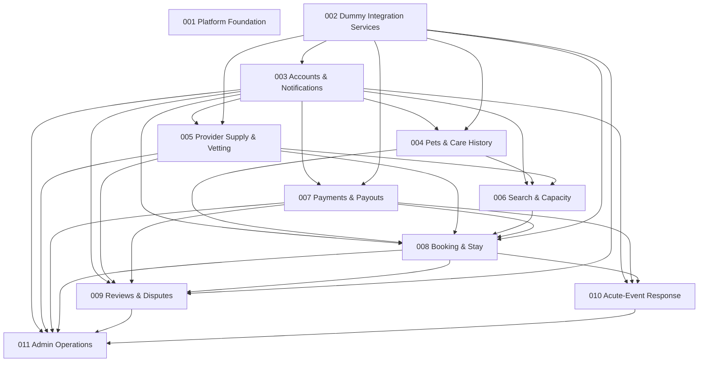

# PetCare v1 - Unit Decomposition

PetCare decomposes into **11 capability units**, not one per surface. Each domain unit is a **vertical slice**: its API, its data and the screens from the [experience blueprint](experience-blueprint.md) that expose it, so every bolt can show something working. Shared UI, navigation, i18n, PWA shell and configuration live once in Platform Foundation.

| # | Unit | Bolt type | Size | Screens | Depends on |
|---|---|---|---|---|---|
| 001 | **Platform Foundation** | simple | L | App shell and navigation for all roles; shared states | none |
| 002 | **Dummy Integration Services** | simple | L | None | none |
| 003 | **Accounts & Notifications** | simple | M | O2 Sign in, O9 Inbox, O10 Settings, provider and admin inbox/settings, admin sign-in | 001, 002 |
| 004 | **Pets & Care History** | simple | M | O8 Pets | 001, 003, 002 |
| 005 | **Provider Supply & Vetting** | simple | L | O4 Provider, P6 Profile (edit tab), A4 provider page (vetting) | 001, 003, 002 |
| 006 | **Search & Capacity** | ddd | L | O1 Home, O3 Results, P2 Calendar | 001, 003, 004, 005 |
| 007 | **Payments & Payouts** | ddd | L | P5 Earnings, A6 Payouts | 001, 003, 002 |
| 008 | **Booking & Stay** | ddd | XL | O5 Book, O6 Booking, O7 Bookings, P1 Today, P3 Booking, P4 Bookings | 001, 003, 004, 005, 006, 007, 002 |
| 009 | **Reviews & Disputes** | ddd | L | O6 Booking (review and report sections), P6 Profile (care record tab), A3 Report, A5 Reviews | 001, 003, 005, 007, 008, 002 |
| 010 | **Acute-Event Response** | ddd | L | P3 Booking (Report a concern sheet), O6 Booking (acute banner), A2 Acute event | 001, 003, 007, 008 |
| 011 | **Admin Operations** | simple | M | A1 Queue, A4 Providers (list and flags), A7 Insights, A8 Audit log | 001, 003, 005, 007, 008, 009, 010 |

### 001 Platform Foundation

**Responsibility:** What every screen and service stands on: workspace layout, DESIGN.md tokens and the shared UI kit, the app shell and navigation for each role, i18n (Bangla default, English parity), PWA shell, shared error/empty/loading/offline states, the single configuration module for training decisions, and database and logging primitives.

**Why separate:** Shared kernel: tokens, navigation, i18n and configuration exist once, so no unit hard-codes a TD value, a colour or a string.

**Requirements:** FR-46 (Responsive PWA), FR-47 (Bangla/English parity), DR-18 (Connectivity, empty, error, loading states), DR-19 (WCAG 2.1 AA), DR-22 (Ports and adapters only)

**Dependencies:** none · **Bolt type:** simple-construction-bolt · **Brief:** [units/001-platform-foundation/unit-brief.md](units/001-platform-foundation/unit-brief.md)

### 002 Dummy Integration Services

**Responsibility:** The five separately runnable training APIs that stand in for the payment gateway, MFS payout rail, SMS/OTP, notifications and photo storage, each with health, reset, inspection and failure modes.

**Why separate:** Workbook Rule 5: dummies are real development artifacts with their own lifecycle and tests; they must run and be tested before any PetCare unit consumes them.

**Requirements:** TR-1..TR-8 (training-only behaviour)

**Dependencies:** none · **Bolt type:** simple-construction-bolt · **Brief:** [units/002-dummy-integration-services/unit-brief.md](units/002-dummy-integration-services/unit-brief.md)

### 003 Accounts & Notifications

**Responsibility:** Who the person is and how the platform talks to them: phone-OTP sign-in for owners and providers, separate admin sign-in, roles, settings, the notification port, and one inbox per role. No native push.

**Why separate:** Identity and messaging are used by every other unit; one sign-in, one inbox and one notification port keep the experience consistent and keep delivery failures from blocking business actions.

**Requirements:** FR-31 (Admin role and authentication), DR-1 (Phone-OTP sign-in), DR-2 (OTP failure handling), DR-3 (Role separation), DR-20 (Notifications without native push), DR-21 (Safe failure of the external ports this unit uses)

**Dependencies:** 001 Platform Foundation, 002 Dummy Integration Services · **Bolt type:** simple-construction-bolt · **Brief:** [units/003-accounts-notifications/unit-brief.md](units/003-accounts-notifications/unit-brief.md)

### 004 Pets & Care History

**Responsibility:** The owner's pets and their growing care history: structured profile and care plan, pre-fill for the next booking, a read-only summary for providers, 24-month retention.

**Why separate:** The care history is the product's moat and has its own visibility and retention rules, independent of any single booking.

**Requirements:** FR-6 (Pet profile creation), FR-7 (Care history persistence), FR-8 (Care history pre-fill), FR-9 (Care history visible to provider), FR-10 (Record retention (24 months)), DR-4 (Structured care configuration), DR-5 (Clinical requests rejected at intake), DR-21 (Safe failure of the external ports this unit uses)

**Dependencies:** 001 Platform Foundation, 003 Accounts & Notifications, 002 Dummy Integration Services · **Bolt type:** simple-construction-bolt · **Brief:** [units/004-pet-care-profile/unit-brief.md](units/004-pet-care-profile/unit-brief.md)

### 005 Provider Supply & Vetting

**Responsibility:** Curated supply: tiers, admin-gated vetting with private verification artifacts, the public provider page with its badge, and the provider's own profile editor.

**Why separate:** Supply curation is the credibility gate; its lifecycle and privacy rules do not depend on bookings.

**Requirements:** FR-1 (Tiered supply structure), FR-2 (Admin-gated vetting), FR-3 (Minimum vetting bar), FR-4 (Vetting bias audit, right of appeal), FR-5 (Provider profile completeness, badge), FR-33 (Provider intake and vetting workflow), DR-21 (Safe failure of the external ports this unit uses)

**Dependencies:** 001 Platform Foundation, 003 Accounts & Notifications, 002 Dummy Integration Services · **Bolt type:** simple-construction-bolt · **Brief:** [units/005-provider-supply-vetting/unit-brief.md](units/005-provider-supply-vetting/unit-brief.md)

### 006 Search & Capacity

**Responsibility:** Per-night capacity and the curated shortlist: a provider is shown only if every night has room, and a request against a full night is blocked at submission.

**Why separate:** Capacity has exact boundary and concurrency rules and a hard p95 target; booking calls it, it does not own it.

**Requirements:** FR-11 (Curated search default), FR-12 (Date-level capacity), FR-13 (Launch neighbourhoods, density), DR-6 (Search ranking rules, p95 < 1 s), DR-7 (Exact capacity boundaries), DR-8 (Last-slot race safety)

**Dependencies:** 001 Platform Foundation, 003 Accounts & Notifications, 004 Pets & Care History, 005 Provider Supply & Vetting · **Bolt type:** ddd-construction-bolt · **Brief:** [units/006-search-capacity/unit-brief.md](units/006-search-capacity/unit-brief.md)

### 007 Payments & Payouts

**Responsibility:** All money rules: authorize, capture on confirmation, release, refund, commission, weekly payout, freeze and release, reconciliation, with idempotency everywhere.

**Why separate:** Payments are separate from the booking flow but connected through a narrow interface, so money safety is tested on its own.

**Requirements:** FR-39 (Capture-on-confirmation), FR-40 (MFS-first rails, card secondary), FR-41 (Commission and payout), FR-42 (Refund mechanics), DR-9 (Payment failure paths), DR-13 (Idempotent capture), DR-14 (Payout failure safety), DR-17 (Payout reconciliation view), DR-21 (Safe failure of the external ports this unit uses)

**Dependencies:** 001 Platform Foundation, 003 Accounts & Notifications, 002 Dummy Integration Services · **Bolt type:** ddd-construction-bolt · **Brief:** [units/007-payments-payouts/unit-brief.md](units/007-payments-payouts/unit-brief.md)

### 008 Booking & Stay

**Responsibility:** The spine of the product and its two booking pages: the state machine from request to completion, provider confirm or structured decline, cancellations and no-shows, the stay itself (daily updates, chat, vet clinics), and Book again.

**Why separate:** The booking lifecycle is a domain, not a screen; keeping the stay in the same unit matches the one-booking-one-page experience and keeps every booking state in one model.

**Requirements:** FR-14 (Booking state machine), FR-15 (Booking request and authorization), FR-16 (Provider confirmation), FR-17 (Structured decline), FR-18 (Stay period, confirmation-to-stay SLA), FR-19 (Completion, capture-to-payout), FR-43 (Daily updates), FR-44 (Booking-scoped chat), FR-45 (Vet-clinic directory), FR-48 (Owner repeat booking (Book again)), FR-49 (Provider repeat tooling), DR-10 (Offline-tolerant submit), DR-11 (Cancellation and no-show transitions (TD-6)), DR-12 (Confirmation-window timeout (TD-1)), DR-21 (Safe failure of the external ports this unit uses)

**Dependencies:** 001 Platform Foundation, 003 Accounts & Notifications, 004 Pets & Care History, 005 Provider Supply & Vetting, 006 Search & Capacity, 007 Payments & Payouts, 002 Dummy Integration Services · **Bolt type:** ddd-construction-bolt · **Brief:** [units/008-booking-stay/unit-brief.md](units/008-booking-stay/unit-brief.md)

### 009 Reviews & Disputes

**Responsibility:** What happens after the stay: verified reviews with photos and the trust numbers computed from real records, and the report-a-problem path with payout freeze, admin investigation and refund. Reviews and reports stay independent records (FR-22).

**Why separate:** Both are post-stay trust mechanisms reached from the same booking page and worked by the same admin; they share one unit while their records stay independent.

**Requirements:** FR-20 (Review gating, one per booking), FR-21 (Review content, photos), FR-22 (Review independent of report), FR-23 (Review visibility, moderation), FR-24 (Report an issue in dispute window), FR-25 (Admin investigation, resolution), FR-35 (Report investigation, dispute resolution), DR-15 (No fabricated trust signals), DR-21 (Safe failure of the external ports this unit uses)

**Dependencies:** 001 Platform Foundation, 003 Accounts & Notifications, 005 Provider Supply & Vetting, 007 Payments & Payouts, 008 Booking & Stay, 002 Dummy Integration Services · **Bolt type:** ddd-construction-bolt · **Brief:** [units/009-reviews-disputes/unit-brief.md](units/009-reviews-disputes/unit-brief.md)

### 010 Acute-Event Response

**Responsibility:** The launch-blocking runbook: provider 'Report a concern', admin coordination, vet clinics, owner notification, payout freeze, timeline, post-mortem.

**Why separate:** A launch-blocking, time-critical flow with its own state and roles, kept apart from disputes.

**Requirements:** FR-26 (Acute-event trigger), FR-27 (Admin coordination, owner cadence), FR-28 (Vet directory in acute event), FR-29 (Payout/report implications of acute event), FR-30 (Post-mortem loop), FR-34 (Acute-event coordination surface), DR-16 (Acute-event timing measured)

**Dependencies:** 001 Platform Foundation, 003 Accounts & Notifications, 007 Payments & Payouts, 008 Booking & Stay · **Bolt type:** ddd-construction-bolt · **Brief:** [units/010-acute-event-response/unit-brief.md](units/010-acute-event-response/unit-brief.md)

### 011 Admin Operations

**Responsibility:** The single operator's overview: urgency queue, audit log, operating ceiling, provider health and utilization flags, defection signals. It reads from every unit and owns no workflow.

**Why separate:** Read-model aggregation across all domains, built last so it never owns another unit's rules.

**Requirements:** FR-32 (Queue dashboard), FR-36 (Defection detection, re-engagement), FR-37 (Audit log), FR-38 (Operating-ceiling monitoring), FR-50 (Defection signal capture)

**Dependencies:** 001 Platform Foundation, 003 Accounts & Notifications, 005 Provider Supply & Vetting, 007 Payments & Payouts, 008 Booking & Stay, 009 Reviews & Disputes, 010 Acute-Event Response · **Bolt type:** simple-construction-bolt · **Brief:** [units/011-admin-operations/unit-brief.md](units/011-admin-operations/unit-brief.md)

## Requirement-to-unit mapping (every in-build FR in exactly one unit)

| FR | Requirement | Unit |
|---|---|---|
| FR-1 | Tiered supply structure | 005-provider-supply-vetting |
| FR-2 | Admin-gated vetting | 005-provider-supply-vetting |
| FR-3 | Minimum vetting bar | 005-provider-supply-vetting |
| FR-4 | Vetting bias audit, right of appeal | 005-provider-supply-vetting |
| FR-5 | Provider profile completeness, badge | 005-provider-supply-vetting |
| FR-6 | Pet profile creation | 004-pet-care-profile |
| FR-7 | Care history persistence | 004-pet-care-profile |
| FR-8 | Care history pre-fill | 004-pet-care-profile |
| FR-9 | Care history visible to provider | 004-pet-care-profile |
| FR-10 | Record retention (24 months) | 004-pet-care-profile |
| FR-11 | Curated search default | 006-search-capacity |
| FR-12 | Date-level capacity | 006-search-capacity |
| FR-13 | Launch neighbourhoods, density | 006-search-capacity |
| FR-14 | Booking state machine | 008-booking-stay |
| FR-15 | Booking request and authorization | 008-booking-stay |
| FR-16 | Provider confirmation | 008-booking-stay |
| FR-17 | Structured decline | 008-booking-stay |
| FR-18 | Stay period, confirmation-to-stay SLA | 008-booking-stay |
| FR-19 | Completion, capture-to-payout | 008-booking-stay |
| FR-20 | Review gating, one per booking | 009-reviews-disputes |
| FR-21 | Review content, photos | 009-reviews-disputes |
| FR-22 | Review independent of report | 009-reviews-disputes |
| FR-23 | Review visibility, moderation | 009-reviews-disputes |
| FR-24 | Report an issue in dispute window | 009-reviews-disputes |
| FR-25 | Admin investigation, resolution | 009-reviews-disputes |
| FR-26 | Acute-event trigger | 010-acute-event-response |
| FR-27 | Admin coordination, owner cadence | 010-acute-event-response |
| FR-28 | Vet directory in acute event | 010-acute-event-response |
| FR-29 | Payout/report implications of acute event | 010-acute-event-response |
| FR-30 | Post-mortem loop | 010-acute-event-response |
| FR-31 | Admin role and authentication | 003-accounts-notifications |
| FR-32 | Queue dashboard | 011-admin-operations |
| FR-33 | Provider intake and vetting workflow | 005-provider-supply-vetting |
| FR-34 | Acute-event coordination surface | 010-acute-event-response |
| FR-35 | Report investigation, dispute resolution | 009-reviews-disputes |
| FR-36 | Defection detection, re-engagement | 011-admin-operations |
| FR-37 | Audit log | 011-admin-operations |
| FR-38 | Operating-ceiling monitoring | 011-admin-operations |
| FR-39 | Capture-on-confirmation | 007-payments-payouts |
| FR-40 | MFS-first rails, card secondary | 007-payments-payouts |
| FR-41 | Commission and payout | 007-payments-payouts |
| FR-42 | Refund mechanics | 007-payments-payouts |
| FR-43 | Daily updates | 008-booking-stay |
| FR-44 | Booking-scoped chat | 008-booking-stay |
| FR-45 | Vet-clinic directory | 008-booking-stay |
| FR-46 | Responsive PWA | 001-platform-foundation |
| FR-47 | Bangla/English parity | 001-platform-foundation |
| FR-48 | Owner repeat booking (Book again) | 008-booking-stay |
| FR-49 | Provider repeat tooling | 008-booking-stay |
| FR-50 | Defection signal capture | 011-admin-operations |
| FR-51 | Pre-launch demand validation | out of build scope |
| FR-52 | Pre-launch supply assessment | out of build scope |

All derived requirements DR-1..DR-22 are assigned (see each brief; DR-21 is proved by every unit that uses an external port). Dummy behaviour TR-1..TR-8 belongs to 002. NFRs are shared budgets set up in 001 and verified in each unit.

## Page-spec-to-unit mapping (all 43)

| Page spec | Unit |
|---|---|
| 1.1 | 006-search-capacity |
| 1.2 | 003-accounts-notifications |
| 1.3 | 006-search-capacity |
| 1.4 | 005-provider-supply-vetting |
| 1.5 | 004-pet-care-profile |
| 1.6 | 008-booking-stay |
| 1.7 | 008-booking-stay |
| 1.8 | 008-booking-stay |
| 2.1 | 004-pet-care-profile |
| 2.2 | 008-booking-stay |
| 3.1 | 008-booking-stay |
| 3.2 | 006-search-capacity |
| 3.3 | 008-booking-stay |
| 3.4 | 008-booking-stay |
| 3.5 | 008-booking-stay |
| 3.6 | 008-booking-stay |
| 3.7 | 008-booking-stay |
| 3.8 | 005-provider-supply-vetting |
| 3.9 | 009-reviews-disputes |
| 3.10 | 007-payments-payouts |
| 4.1 | 011-admin-operations |
| 4.2 | 010-acute-event-response |
| 4.3 | 005-provider-supply-vetting |
| 4.4 | 011-admin-operations |
| 4.5 | 011-admin-operations |
| 4.6 | 009-reviews-disputes |
| 4.7 | 009-reviews-disputes |
| 4.8 | 007-payments-payouts |
| 4.9 | 010-acute-event-response |
| 4.10 | 011-admin-operations |
| 5.1 | 008-booking-stay |
| 5.2 | 009-reviews-disputes |
| 5.3 | 009-reviews-disputes |
| 5.4 | 009-reviews-disputes |
| 5.5 | 003-accounts-notifications |
| 5.6 | 007-payments-payouts |
| 5.7 | 010-acute-event-response |
| 5.8 | 011-admin-operations |
| 5.9 | 003-accounts-notifications |
| 5.10 | 003-accounts-notifications |
| 5.11 | 001-platform-foundation |
| 5.12 | 001-platform-foundation |
| 5.13 | 001-platform-foundation |

## Dependency graph

Every unit depends on 001 Platform Foundation; those edges are left out so the graph stays readable.

## Build order (dependency waves)

1. 001 Platform Foundation, 002 Dummy Integration Services
2. 003 Accounts & Notifications
3. 004 Pets & Care History, 005 Provider Supply & Vetting, 007 Payments & Payouts
4. 006 Search & Capacity
5. 008 Booking & Stay
6. 009 Reviews & Disputes, 010 Acute-Event Response
7. 011 Admin Operations

The Bolt Plan (Step 12) cuts across these waves to deliver a thin end-to-end slice first (foundation, dummies, sign-in, one booking from request to confirmation).

## Decisions for Checkpoint 3

- **UD-1 Vertical slices** (API + screens per unit) instead of the catalog's single frontend unit, so every bolt is demonstrable.
- **UD-2 Eleven units, simplified from fourteen:** Notifications merged into Accounts (one sign-in, one inbox, one port); In-Stay Communication merged into Booking & Stay (one booking page per role); Reviews and Disputes merged into one post-stay unit (records stay independent per FR-22).
- **UD-3 Bolt types:** DDD for Search & Capacity, Payments & Payouts, Booking & Stay, Reviews & Disputes, Acute-Event Response (as the workbook asks); Simple for the other six.
- **UD-4 Admin Operations last,** reading from every unit and owning no workflow.
- **UD-5 Screens follow the experience blueprint** (24 screens covering all 43 page specs).

## Checkpoint 3 self-check

- [x] Every in-scope FR belongs to exactly one unit (script-checked)
- [x] Units are capability-oriented, not per surface
- [x] Dependencies are acyclic and numbered in build order (script-checked)
- [x] Booking lifecycle is a domain (008), not a screen
- [x] Payments and payouts (007) are separate from booking and connected by authorize/capture/release/freeze/refund
- [x] Integrations separated: Dummy services in 002; each consuming unit owns its adapter

## Stories

| Unit | Stories | Must | Should |
|---|---|---|---|
| 001-platform-foundation | 7 | 6 | 1 |
| 002-dummy-integration-services | 5 | 5 | 0 |
| 003-accounts-notifications | 5 | 3 | 2 |
| 004-pet-care-profile | 7 | 6 | 1 |
| 005-provider-supply-vetting | 5 | 3 | 2 |
| 006-search-capacity | 6 | 5 | 1 |
| 007-payments-payouts | 8 | 6 | 2 |
| 008-booking-stay | 18 | 16 | 2 |
| 009-reviews-disputes | 6 | 5 | 1 |
| 010-acute-event-response | 4 | 4 | 0 |
| 011-admin-operations | 5 | 2 | 3 |
| **Total** | **76** | **61** | **15** |

Full list: [story-index.md](../../story-index.md).
